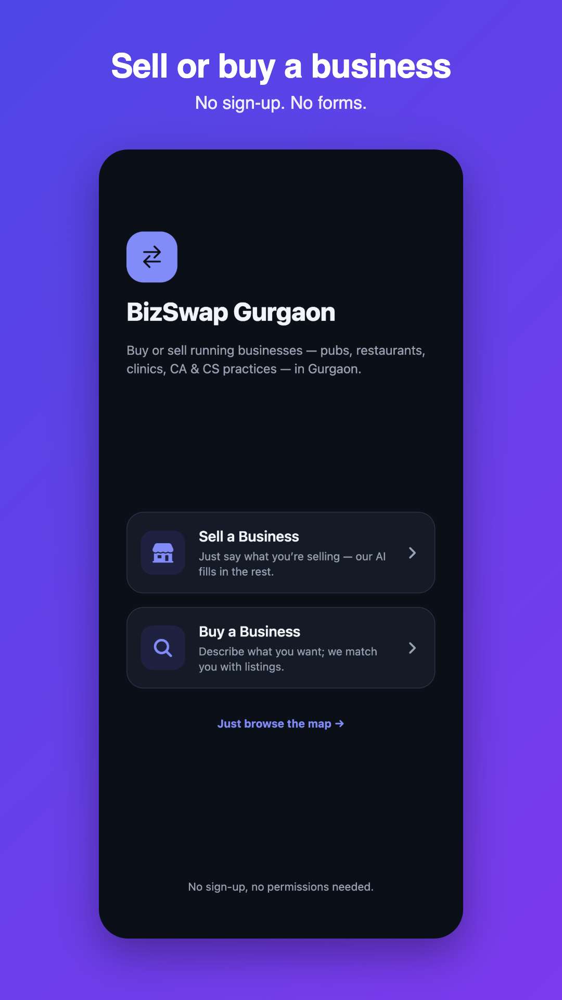
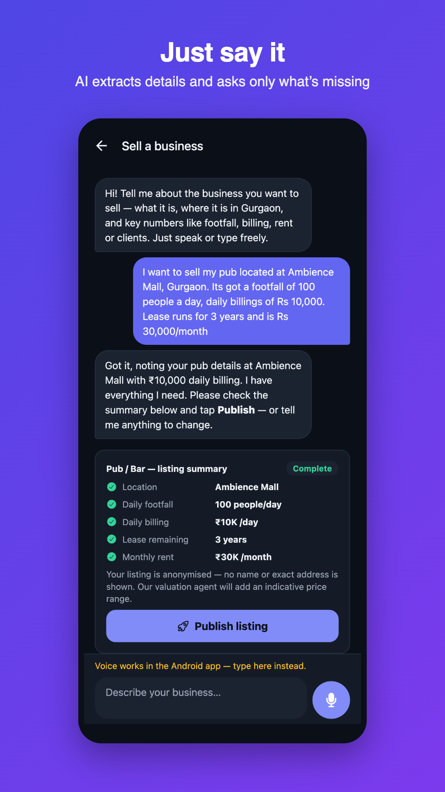
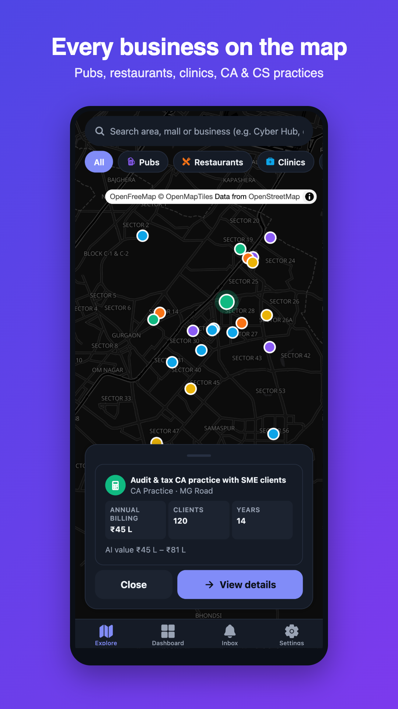
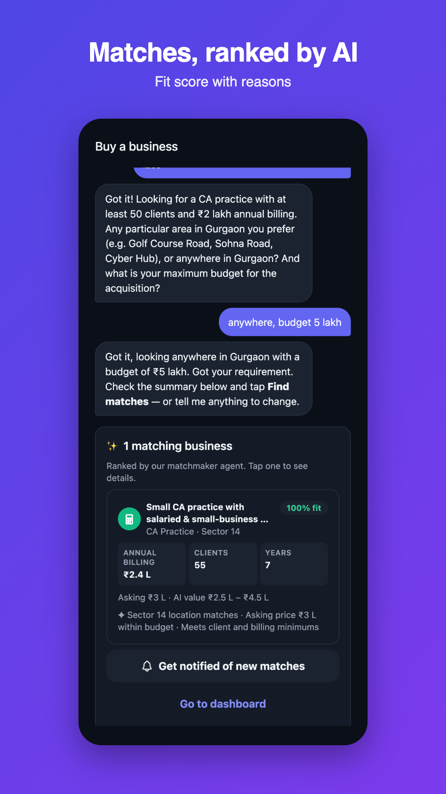
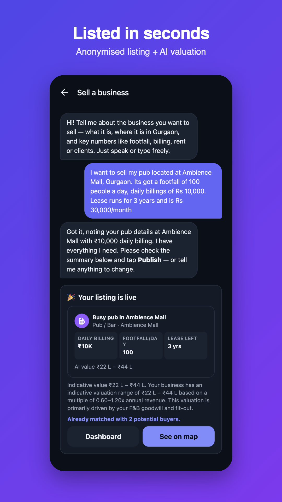
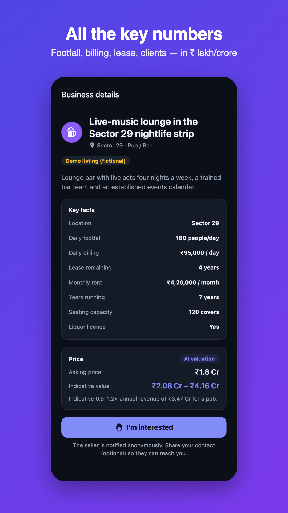
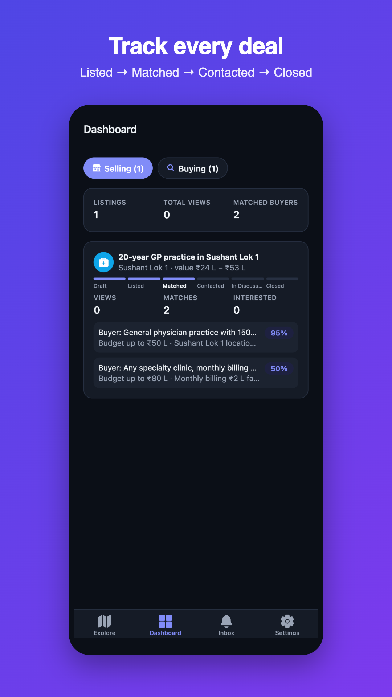
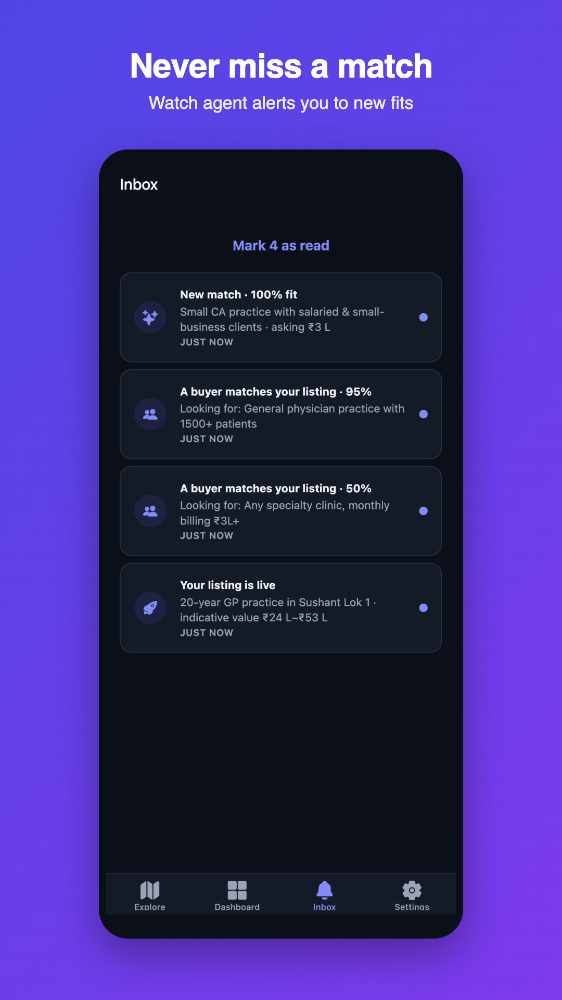
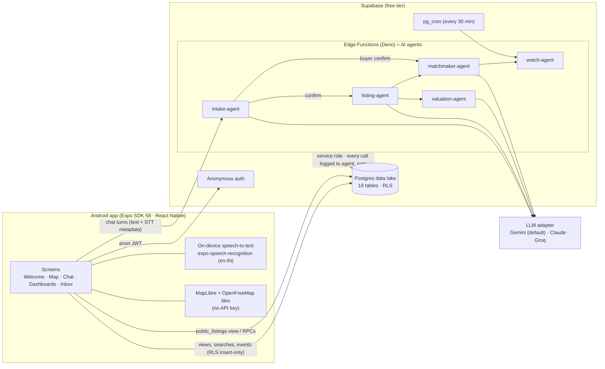
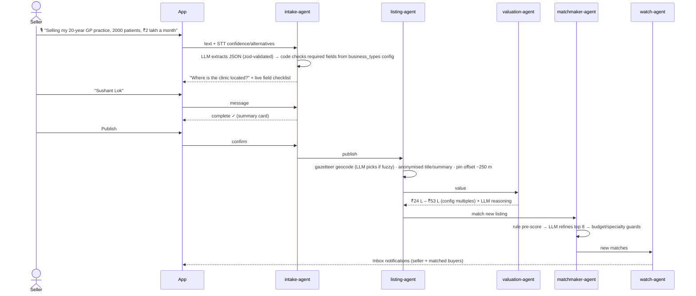

# BizSwap Gurgaon

**An AI-native Android marketplace for buying and selling running businesses in Gurgaon** (pubs, restaurants, doctor clinics, CA and CS practices).

Sellers and buyers never fill in a form. They just **speak or type**. Six AI agents do the rest: they extract the details, ask for anything missing, geocode the location, write an anonymised listing, value the business, match buyers with sellers, and watch for new matches.

**▶ Live web demo: https://jay0085-cdr.github.io/bizswap-gurgaon/** (voice input is Android-only; type on web)

Built as a 2-day internship MVP for WildCatter Ventures. **Zero cost:** only free tiers, with no credit card anywhere.

| | | | |
|---|---|---|---|
|  |  |  |  |
|  |  |  |  |

> These screenshots come from the web build, driven automatically by `scripts/ui-check.mts`. Device screenshots can be swapped in after the first APK install.

---

## Architecture



### Seller flow (no forms)



## The agents

| Agent | What it does | Fallback if the LLM is unavailable |
|---|---|---|
| **intake-agent** | Turns free text or voice into structured JSON for the business type's schema (from the `business_types` table). Normalises Indian amounts ("2 lacs" → 200000, "10k", "1.5 cr"). Handles corrections and Hinglish. **Code, not the LLM**, works out which required fields are missing and asks for at most two at a time. | Regex extractor plus gazetteer matching, so a seller is never stuck |
| **listing-agent** | Geocodes against a static 46-place Gurgaon gazetteer (exact alias first, then the LLM picks the nearest known place). Writes an anonymised title and summary. Offsets the pin. Publishes the listing and triggers valuation and matching. | Template copy |
| **valuation-agent** | Computes an indicative range from config multiples (for example a pub at 0.6–1.2× annual revenue, a CA practice at 1.0–1.8× fees), adjusted for a short lease or a long track record. The LLM only writes the 2-sentence explanation and never changes the numbers. | Template reasoning |
| **matchmaker-agent** | Scores listing↔requirement fit from 0 to 100. A deterministic pre-score (distance, budget and size minimums) shortlists candidates, one batched LLM call refines the top 8 with reasons, and hard guards (price > 2× budget, wrong specialty) cap the score. | Pre-score only |
| **feedback-agent** | Admin-only. Clusters closed-test feedback (sent from the in-app feedback button, tagged with app version and screen) into themes, with severity, a summary and a suggested fix. **Code** counts items and testers and ranks themes by frequency × severity, then stores the report in `feedback_reports`. Run with `npm run feedback`. | Keyword grouping |
| **watch-agent** | Turns new matches into inbox notifications for buyers and sellers, keeps saved searches for users who shared contact details, and runs a pg_cron sweep every 30 minutes. | — (no LLM) |

**Provider-swappable:** set `LLM_PROVIDER=gemini|anthropic|groq` and `LLM_MODEL`, and optionally `LLM_FALLBACK_PROVIDER`. Gemini uses the Interactions API with a JSON schema, Claude uses forced tool use, and Groq uses OpenAI-compatible JSON mode. Every call is validated with zod, retried once with the validation error if it fails, and **logged to `agent_runs`** (input, output, model, latency, tokens).

**Adding a business type needs no code.** Add an entry to `shared/business-types.json` (fields, which are required, the follow-up question for each, valuation multiples), then run `npm run db:push`.

## Data lake

Postgres records every field and event with timestamps and anonymous IDs:

- **Identity:** `profiles` (anonymous user plus random install ID), `contacts` (optional phone/email with consent)
- **Raw conversation:** `conversations` (extracted JSON, missing fields), `messages` (every turn, input mode, raw STT transcript, confidence, alternatives, extracted snapshot), `agent_runs` (every LLM call)
- **Marketplace:** `listings`, `buyer_requirements`, `matches` (score and reasons), `interests`, `stage_history` (filled by triggers)
- **Behaviour:** `events`, `search_events` (query, filters, result count), `listing_views` (source), `saved_searches`, `notifications`
- **Config:** `business_types`, `localities`, `app_config`

RLS is on for every table. Clients can only read their own rows and can only insert events. The public catalogue is the `public_listings` view, which never exposes seller identity. Pipeline stages are Draft → Listed → Matched → Contacted → In Discussion → Closed.

## Setup (about 10 minutes, all free)

**You need:** macOS/Linux, Node ≥ 22.13, and Google Chrome (only for the UI check and asset scripts).

1. **Create the accounts** (none need a card):
   - [Supabase](https://supabase.com): create a project and note its **project ref** and **DB password**. Then create a **personal access token** at Account → Access Tokens.
   - [Google AI Studio](https://aistudio.google.com): create a **Gemini API key**.
   - [Expo](https://expo.dev): create an account, then an **access token** at Account settings → Access tokens.
2. **Create `.env.local`** in the repo root. It's gitignored, and these values never ship in the app:
   ```
   SUPABASE_PROJECT_REF=your-project-ref
   SUPABASE_DB_PASSWORD=...
   SUPABASE_ACCESS_TOKEN=sbp_...
   GEMINI_API_KEY=...
   EXPO_TOKEN=...
   ```
3. **Run it:**
   ```bash
   npm install
   npm run setup     # link → anon auth → migrations + seed → secrets → deploy 5 agents → app env → seed matchmaking → cron
   npm run smoke     # end-to-end agent tests on the brief's example sentences
   npm run web       # instant browser preview
   ```
4. **Build Android:**
   ```bash
   npx eas-cli init            # once: links the Expo project (writes projectId into app.json)
   npm run build:apk           # installable preview APK (QR code / link from EAS)
   npm run build:aab           # signed Play Store bundle (EAS-managed keystore)
   npm run build:dev           # optional dev-client APK for hot reload with `npm start`
   ```

### Privacy policy
Live at https://jay0085-cdr.github.io/bizswap-gurgaon/privacy/. It is published with the web demo by `npm run web:deploy` (GitHub Pages, `gh-pages` branch).

### Upload to Play
Everything is in `/store`: the icon, feature graphic, eight 9:16 screenshots, the full listing text, and suggested Data safety and content-rating answers in `store/listing-en.md`. Upload the `.aab` from `npm run build:aab`.

## Commands

| Command | What it does |
|---|---|
| `npm run check` | TypeScript + ESLint |
| `npm run smoke` | Agent end-to-end tests (19 checks) against the live backend |
| `node scripts/ui-check.mts all` | Headless Chrome drives the real UI (seller → buyer → dashboards → inbox → map) and saves screenshots |
| `npm run assets` | Regenerates the icon, splash, feature graphic, Play screenshots and privacy HTML from code |
| `npm run db:push` | Regenerates the seed and pushes migrations (needs only the DB password) |
| `npm run functions:deploy` | Redeploys all agents |
| `npm run feedback` | Runs the feedback-agent and prints the ranked tester-feedback report |
| `npm run web:deploy` | Builds the web app, checks it for leaked secrets, publishes it plus the privacy policy to GitHub Pages (`gh-pages` branch) |

## Project layout

```
src/app/            Expo Router screens            src/components/  UI primitives, map (native + web), cards
src/lib/            supabase, agents client, tracking, ₹ formatting, config
shared/             business-types.json, localities.json  ← single source of truth (app, seed, agents)
supabase/           migrations, seed.sql, functions/{intake,listing,valuation,matchmaker,watch}-agent + _shared
scripts/            setup, deploy, seed generator, smoke tests, UI check, store-asset generator
store/              Play Store assets + listing text      docs/  AI build log, privacy page
```

## Zero-cost choices

| Need | Free choice | Instead of |
|---|---|---|
| LLM | Gemini free tier (`gemini-3.5-flash-lite`, ~2 s per call) | Paid APIs |
| Map | MapLibre + OpenFreeMap (OSM) | Google Maps key |
| Geocoding | Static gazetteer of 46 Gurgaon places plus an LLM nearest-place pick | Paid geocoders |
| Speech | On-device Android recogniser | Cloud STT |
| Backend | Supabase free tier | Paid servers |
| Builds | EAS free tier | Local Android Studio |

Known free-tier limits: the Gemini free quota is small and set per project (every agent degrades gracefully), and Supabase pauses a project after 7 days with no activity.

## AI-built

The whole codebase was written by Claude Code (Claude Opus 5.5), including SQL, agents, UI, tests, assets and docs. See [`docs/AI_BUILD_LOG.md`](docs/AI_BUILD_LOG.md) for what was generated at each milestone and the bugs the AI's own tests caught.

*All demo listings are fictional.*
